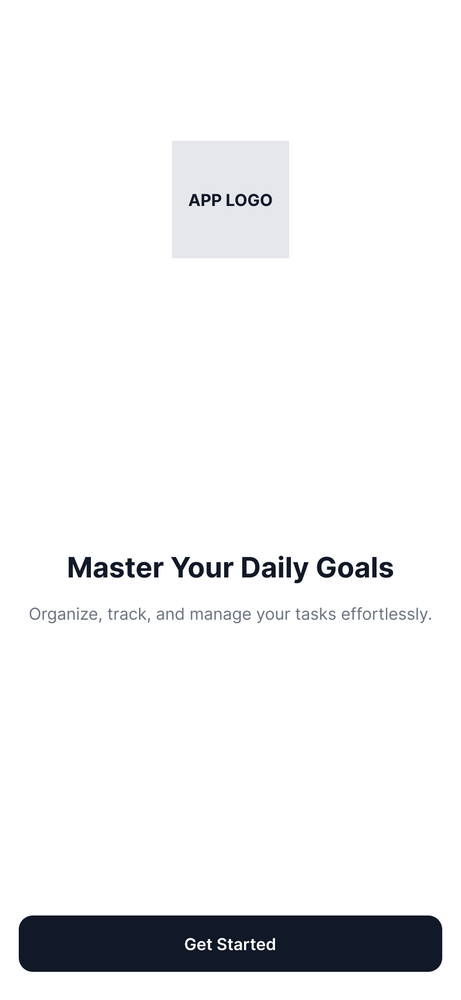
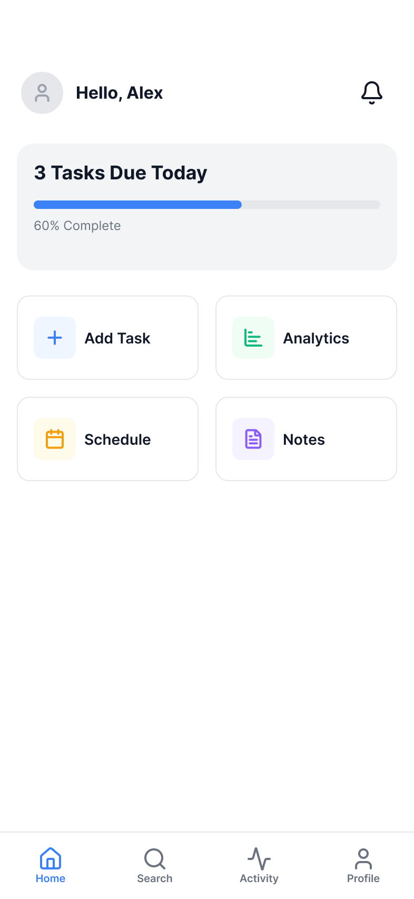
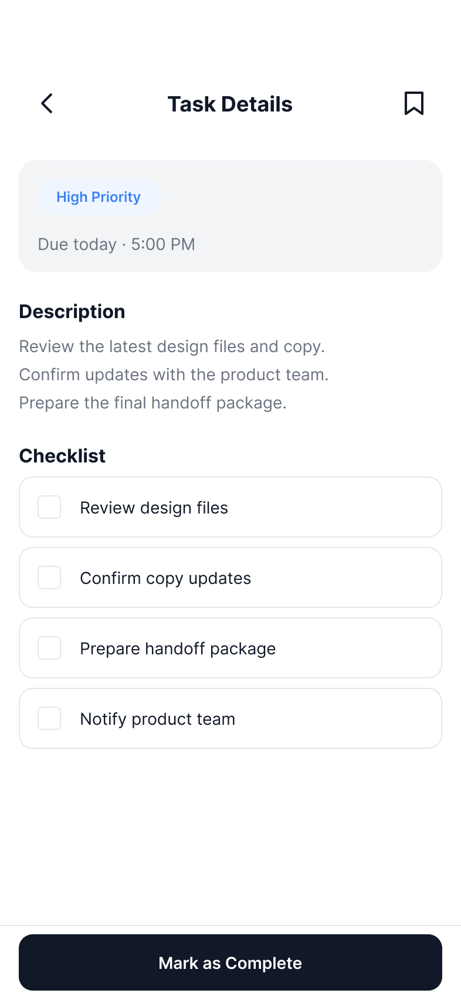
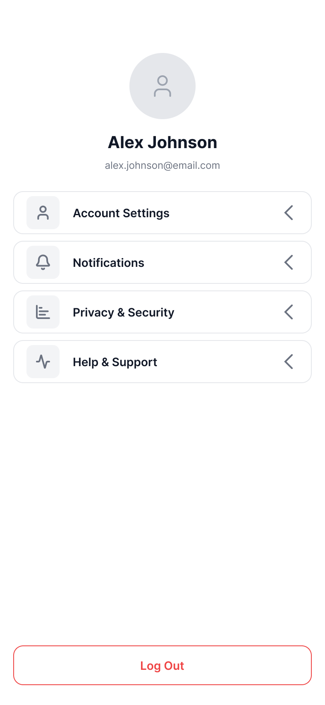

# Mobile App Wireframes & Information Architecture

## 1. Project Overview
This project presents low/mid-fidelity wireframes for a task management mobile application built with focus on structural usability, accessibility (minimum 44x44px touch targets), and ergonomic 8pt grid alignment.

---

## 2. User Persona & Problem Statement
* **User Persona:** Alex, a busy university student and freelance worker balancing daily coursework, client deadlines, and personal projects.
* **Problem Statement:** Mobile users frequently abandon productivity apps due to overcrowded dashboards, hard-to-tap UI elements, and dead-end navigation pathways.
* **Solution:** A clean 4-screen layout with intuitive visual hierarchy, accessible tap targets, and seamless bidirectional screen navigation.

---

## 3. Information Architecture & Key Screens

### Screen Designs
| 01 Splash Screen | 02 Home Dashboard | 03 Detail View | 04 Profile & Settings |
| :---: | :---: | :---: | :---: |
|  |  |  |  |

### Key Components
1. **Onboarding / Splash:** Introduction, brand identity, and single clear action trigger ("Get Started")[cite: 7].
2. **Home Dashboard:** Key progress metrics, quick navigation shortcuts, and recent activity updates[cite: 8].
3. **Detail View:** Deep-dive task view with checklist capabilities and bottom sticky action triggers[cite: 10].
4. **User Profile & Settings:** Profile customization and categorized system preference rows[cite: 9].

---

## 4. User Flow Diagram

```mermaid
graph TD
    A[01_Splash] -->|Tap 'Get Started'| B[02_Home_Dashboard]
    B -->|Tap Task Card / Item| C[Frame03_Detail_View]
    B -->|Tap Profile Avatar| D[04_Profile_Settings]
    C -->|Tap Back Arrow| B
    D -->|Tap Back Arrow / Home| B
    D -->|Tap 'Log Out'| A# mobile-app-wireframes
Mobile application wireframes, information architecture, and user flow specifications built in Figma.
